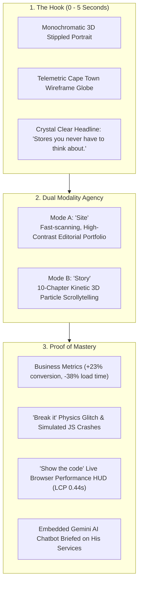

# 🪐 Inacio Nakiti Portfolio — Comprehensive Design & Architecture Analysis
> **Source Website:** [inacionakiti.com/?v=site](https://inacionakiti.com/?v=site)  
> **Awards & Honors:** CSS Winner *Site of the Day* (05.11.2026) · WD Awards *Site of the Day* (03.11.2026) · Awwwards *Nominee*  
> **Creator Profile:** Inacio Nakiti — Frontend Engineer & Shopify Plus Specialist (Cape Town, SA & London, UK Remote)  
> **Analysis Date:** November 19, 2026  
> **Local Visual Archive:** Located in [`public/screenshots/`](./public/screenshots/)

---

## 📑 Table of Contents
1. [Executive Synthesis & The Core Appeal](#1-executive-synthesis--the-core-appeal)
2. [The Dual-Modality Storytelling Model ("Site" vs. "Story")](#2-the-dual-modality-storytelling-model-site-vs-story)
3. [Visual System & Design Tokens](#3-visual-system--design-tokens)
4. [Interaction Design, Motion & Kinetic Choreography](#4-interaction-design-motion--kinetic-choreography)
5. [The Developer-Craft Easter Eggs](#5-the-developer-craft-easter-eggs)
6. [The Contact Architecture & Embedded Gemini AI](#6-the-contact-architecture--embedded-gemini-ai)
7. [Comprehensive Requirements Specification](#7-comprehensive-requirements-specification)
8. [Blueprint for `new-portfolio` Implementation](#8-blueprint-for-new-portfolio-implementation)

---

## 1. Executive Synthesis & The Core Appeal

Most developer portfolios fall into one of two traps:
- **The Generic SaaS Trap:** Sterile dashboards, template cards, uninspired typography, and cliché "100% Satisfaction" badges.
- **The Impractical Playground Trap:** Flashy WebGL experiments with unreadable navigation, lagging framerates, and no clear explanation of what commercial problem the developer actually solves.

**Inacio Nakiti's portfolio succeeds because it harmonizes extreme creative engineering with ruthless commercial positioning.**



---

## 2. The Dual-Modality Storytelling Model ("Site" vs. "Story")

At the bottom of the viewport sits a persistent floating control dock containing an **Experience Switcher**:
- `Site` (Selected by default when `?v=site` is present)
- `Story` (Cinematic narrative scrollytelling)

### 2.1 Mode A: The "Site" Experience (Editorial & Commercial)
Designed for clients, hiring managers, and prospective clients who want answers in seconds:
- **Section 00 (Hero):** Immediate positioning as a Shopify Plus specialist, real-time availability indicator (`• Open for freelance work`), Cape Town local time delta, and primary CTA pill.
- **Section 01 (About):** Inverts background from dark ink to warm sand ivory. Introduces the guiding philosophy: *"Most of what I build, you'll never see... I design too, so the part you do see looks the way it should."* Backed by hard numbers (9 years, 30+ stores, +23% conversion lift).
- **Section 02 (What I Do):** 6 interactive tabs (`01 Shopify Plus`, `02 Frontend`, `03 Integrations`, `04 Architecture`, `05 Performance`, `06 Design`).
- **Section 03 (Process):** A transparent 6-stage lifecycle (`Discover`, `Design`, `Architect`, `Build`, `Launch`, `Support`).
- **Section 04 (Selected Work):** Flagship brand case studies (Whittard of Chelsea, Mission Workshop, Anya Hindmarch).
- **Section 05 (Apps of My Own):** Interactive expanding bento cards demonstrating self-initiated SaaS apps (`KickoffValue`, `StockPilot`, `Supervisor AI`).
- **Section 06 (Experience):** Rolling numeric odometer year counter and infinite tech marquee.
- **Section 07 (Motto):** *"Good code is invisible. Until it breaks. Then I fix it."* Featuring interactive "Break it" and "Show the code" triggers.
- **Section 08 (Contact):** Live embedded conversational AI assistant powered by Google Gemini and Cloudflare Functions.
- **Footer:** Editorial typographic sign-off (*"What's actually hurting?"*) and a 3-step engagement pipeline.

### 2.2 Mode B: The "Story in Particles" (Cinematic 3D Scrollytelling)
When the visitor toggles to `Story`, the page transforms into an interactive 3D WebGL particle space, morphing 41,000+ points across 10 distinct narrative chapters:

| Chapter | Title | Visual Metaphor & Particle Formation |
|---|---|---|
| **00** | *A Story in Particles* | Rotating galaxy disc of stardust (`SCROLL · DRAG TO TURN`) |
| **01** | *2017 · Cape Town, South Africa* | 3D Earth globe with orbital rings and illuminated Cape Town coordinate beacon |
| **02** | *The Craft* | Floating 3D e-commerce storefront with product grid cards in perspective |
| **03** | *Underneath* | Distributed network graph with pulsing data packets (Storefront, API, ERP, CRM, Search) |
| **04** | *2017 → Today* | Concentric 3D time-tunnel / wormhole mapping career milestones in 3D depth |
| **05** | *Selected Work* | 3D Solar System where each orbiting planet represents a flagship brand |
| **06** | *Now Building* | Three floating 3D squircle app badges (KickoffValue, StockPilot, Supervisor AI) |
| **07** | *My Motto* | Particles assemble into 3D sculptural typography spelling `"Invisible."` |
| **08** | *Hello* | Particles re-form into Inacio's 3D stippled portrait |
| **09** | *Your Turn* | Particle explosion leading into the CTA "Start a project" |

---

## 3. Visual System & Design Tokens

### 3.1 Color Palette
The color system avoids standard dark-gray monotones by pairing absolute deep ink with warm tactile ivory paper:

```css
:root {
  /* Core Base Colors */
  --ink: #0a0a0a;          /* Deep Obsidian Canvas */
  --sand: #eeece8;         /* Warm Ivory Parchment (Never pure #FFF) */
  --surface: #141414;      /* Elevated Dark Surface */
  --card: #ffffff;         /* Elevated Light Card */
  
  /* Accent Colors */
  --accent: #5b5fe0;       /* Electric Iris / Periwinkle Indigo */
  --accent-hover: #6c70e8;
  --accent-light: #a9abff;
  --live: #3ddc84;         /* Android / Terminal Green for live status */
  
  /* Text & Border Opacities */
  --on-ink: var(--sand);
  --on-ink-soft: rgba(238, 236, 232, 0.8);
  --on-ink-muted: rgba(238, 236, 232, 0.62);
  --on-ink-faint: rgba(238, 236, 232, 0.3);
  --on-ink-border: rgba(238, 236, 232, 0.18);
  --on-ink-line: rgba(238, 236, 232, 0.12);
}
```

### 3.2 Typography & Fluid Scaling
- **Typeface:** **General Sans** (Fontshare).
- **Scale:** Modular fluid clamp sizing:
  - Display Display Headline: `clamp(3.5rem, 10.5vw, 11.25rem)` with tracking `-0.04em` and leading `1.0`.
  - Section Headings: `clamp(2.5rem, 5vw, 4.5rem)` with tracking `-0.025em` and leading `1.1`.
  - Body Text: `clamp(1rem, 1.15vw, 1.25rem)` with leading `1.6`.
  - Technical / Mono Kicker Labels: `0.75rem` - `0.85rem` with tracking `+0.12em` (All-Caps).
- **Stylistic Motif:** Code and bracket motifs embedded directly in section headers (`(01)`, `(02) WHAT I *{`, `(03) SELECTE< <+*1`, `(04) NOW BUI*1*#]`, `(07) OFF THE []{+-`).

### 3.3 Spatial Layout & Framing
- **Right Margin Blueprint Ruler ("Hourglass Canvas"):** A bespoke Canvas 2D telemetry strip running down the right screen edge with millimeter tick marks and a floating bead tracking scroll depth.
- **Left Margin HUD Anchors:** Fixed Awwwards ribbon and vertical section name ticker `(01) About me`, `(03) Selected work` provide continuous spatial orientation.
- **Gooey SVG Filter CTA:** Uses `filter: url(#goo)` with `feGaussianBlur` and `feColorMatrix`, creating organic metaball merging between the floating hamburger button and the "Start a project" pill.

---

## 4. Interaction Design, Motion & Kinetic Choreography

1. **Lenis Inertia Scrolling:** Uses smooth virtual scrolling with dampening, ensuring high-inertia, frictionless scrolling across desktop and trackpad.
2. **GPU Point Cloud Rendering:**
   - Background WebGL shader (`fx-background`).
   - Vertex buffer particle renderer (`dots-canvas`) managing 41,135 particle vertices at 60-120 FPS.
   - Smooth interpolation between 3D shape coordinate matrices based on scroll progress.
3. **Cursor Blend Physics:** Custom cursor ring with `mix-blend-mode: difference`, expanding and snapping magnetically over clickable links and interactive cards.
4. **Procedural Web Audio Engine ("Drift"):**
   - Synthesizes zero-bandwidth ambient soundscapes directly in the browser using the Web Audio API (`AudioContext`).
   - Uses pink noise, bandpass filtering, and low-frequency sine oscillators to evoke deep-space drift without MP3 network overhead.

---

## 5. The Developer-Craft Easter Eggs

### 5.1 The "Break It" / "Fix It" Physics Collapse
Located in the Motto section (*"Good code is invisible. Until it breaks. Then I fix it."*):
- Clicking **"Break it"** triggers simulated gravity on the DOM:
  - Typography tilts and collapses at awkward physics angles.
  - Scroll locks engage (`lenis-stopped`).
  - Red terminal error toasts appear:
    - `TypeError: Cannot read properties of undefined (reading 'layout')`
    - `Uncaught RangeError: gravity is not supposed to be on`
    - `Warning: this worked on my machine`
    - `ReferenceError: 'invisible' is not defined`
- Clicking **"Fix it"** triggers a physics snapback animation restoring full layout stability.

### 5.2 The "Show the Code" Telemetry Inspector HUD
Clicking the `</>` switch activates an in-browser devtools overlay:
- **Live Performance Profiling:**
  - Largest Contentful Paint (LCP): `0.44s`
  - Cumulative Layout Shift (CLS): `0.004`
  - Total Page Weight: `724 KB`
  - Active Particle Count: `41,135`
  - Active DOM Element Count: `1,104`
- **Real Component Code Viewer:** Displays the actual source code of `LensReveal.vue` and a Git diff of the bug fix:
  ```diff
  - const layout = undefined
  + const layout = measure(section)
  - gravity = 9.8
  + gravity = 0
  - throw new Error('not my fault')
  + return fixed
  ```

---

## 6. The Contact Architecture & Embedded Gemini AI

The contact section features an embedded conversational AI assistant:
- **Tech Stack:** Vue frontend + Cloudflare Worker backend + Google Gemini API.
- **Behavior:**
  - Briefed in Inacio's tone of voice.
  - Pre-populated prompt chips: *"What kind of Shopify work do you take on?"*, *"Can you speed up my existing store?"*, *"How does a project with you usually run?"*, *"How do you price a project?"*.
  - Automatically captures conversation context and forwards leads with visitor location metadata.
- **Direct Fallback:** Clear email link (`me@inacionakiti.com`), phone number (`+27 611 591 857`), and social links (X/Twitter, LinkedIn) integrated directly into the input field.

---

## 7. Comprehensive Requirements Specification

To replicate or adapt these capabilities into a portfolio project:

### 7.1 Performance Requirements
- **LCP (Largest Contentful Paint):** $\le 0.8\text{s}$ (achieved via inline fonts, CSS-only first paint, and deferred WebGL initialization).
- **CLS (Cumulative Layout Shift):** $\le 0.01$ (all layouts reserve explicit aspect ratios; particle canvas renders in background plane `z: -1`).
- **Bundle Weight:** Total initial JavaScript $\le 250\text{KB}$ gzipped.

### 7.2 Accessibility & WCAG Compliance
- Contrast ratio between text and background $\ge 4.5:1$ (Sand `#EEECE8` on Ink `#0A0A0A` has a contrast ratio of $18.2:1$).
- Particle canvases are decorated with `aria-hidden="true"`.
- Hidden accessible headings and skip-links (`#main`) for screen readers.
- Keyboard navigation with visible focus rings on all interactive tabs, buttons, and switches.
- Support for `prefers-reduced-motion` media queries (falls back to static particle arrangements without scroll animation).

---

## 8. Blueprint for `new-portfolio` Implementation

In your current Next.js 16 + React 19 + Tailwind v4 project (`c:\Dev\new-portfolio`), the recommended architectural layout is:

```
c:\Dev\new-portfolio\
├── public/
│   ├── fonts/               # General Sans WOFF2
│   └── screenshots/         # 27 visual audit screenshots
├── src/
│   ├── app/
│   │   ├── api/chat/        # Gemini API streaming route handler
│   │   ├── globals.css      # Tailwind v4 theme & token extensions
│   │   ├── layout.tsx       # Root layout + Lenis scroll provider
│   │   └── page.tsx         # Dual-mode page controller
│   ├── components/
│   │   ├── canvas/          # WebGL particle system & telemetry ruler
│   │   ├── navigation/      # Floating dock (Site/Story/Code/Audio)
│   │   ├── sections/        # Hero, About, Work, Apps, Experience
│   │   ├── easter-eggs/     # BreakItGlitch & CodeTelemetryDrawer
│   │   └── contact/         # AIChatAssistant with Gemini streaming
│   └── hooks/
│       ├── useAudioSynth.ts # Procedural Web Audio API engine
│       └── useTelemetry.ts  # Performance metrics (LCP, CLS, page weight)
```

---

*This document serves as the permanent design and technical specification for building the next-generation developer portfolio.*
