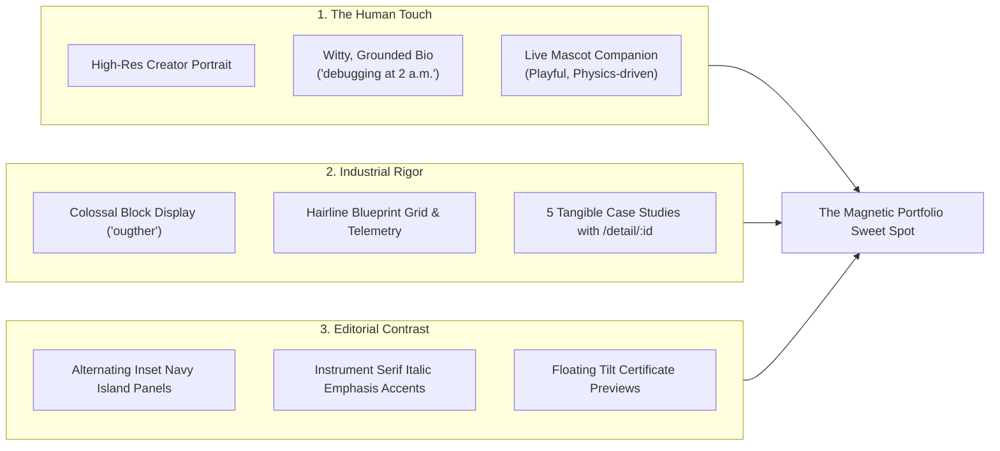
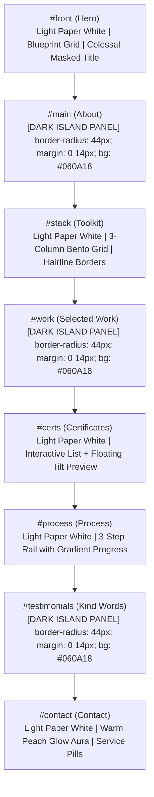
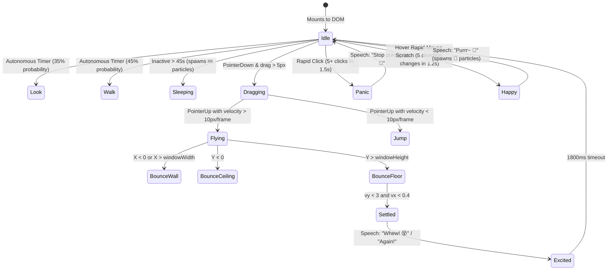
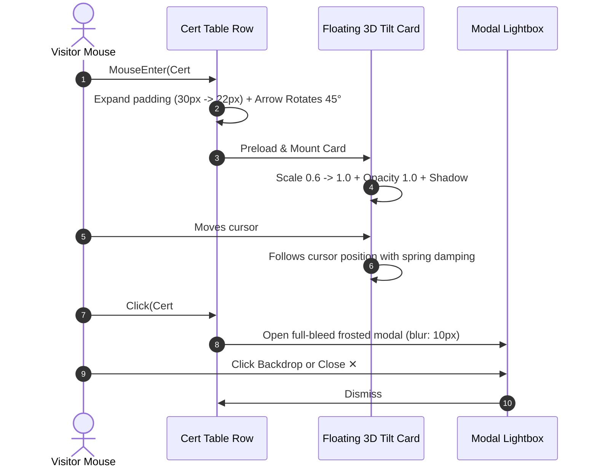

# 🦖 Ariel Angel (Anghel) Portfolio — Deep Dive Design & Architecture Analysis
> **Source Website:** [pork-arie.vercel.app/#main](https://pork-arie.vercel.app/#main)  
> **Creator Profile:** Ariel Angel Bangcale (Anghel) — IT Student & Freelance Web Developer for Small Businesses (Philippines)  
> **Analysis Date:** November 22, 2026  
> **Live Inspected Stack:** React 19, Vite, Tailwind CSS / Custom CSS, Framer Motion, WebP Sprite Canvas, Lucide / Custom SVGs  
> **Companion Analysis:** See [`DESIGN_ANALYSIS.md`](./DESIGN_ANALYSIS.md) for Inacio Nakiti (3D WebGL / Editorial Shopify Specialist)

---

## 📑 Table of Contents
1. [Executive Summary & The "Human Systems Builder" Archetype](#1-executive-summary--the-human-systems-builder-archetype)
2. [Spatial Layout & The Alternating Island Panel Architecture](#2-spatial-layout--the-alternating-island-panel-architecture)
3. [Visual System & Color Chemistry](#3-visual-system--color-chemistry)
4. [Typographic Trio & High-Contrast Pairings](#4-typographic-trio--high-contrast-pairings)
5. [The Interactive Physics Mascot — Complete Technical Teardown](#5-the-interactive-physics-mascot--complete-technical-teardown)
6. [Interactive Certificates & Cursor Hover Preview Mechanics](#6-interactive-certificates--cursor-hover-preview-mechanics)
7. [Motion Choreography & Micro-Interactions](#7-motion-choreography--micro-interactions)
8. [Case Study Architecture (`/detail/:id`)](#8-case-study-architecture-detailid)
9. [Contact Architecture & High-Conversion Funnel](#9-contact-architecture--high-conversion-funnel)
10. [Cross-Inspiration Matrix: Inacio Nakiti vs. Ariel Angel vs. New Portfolio](#10-cross-inspiration-matrix-inacio-nakiti-vs-ariel-angel-vs-new-portfolio)
11. [Concrete Architectural Blueprint for `new-portfolio`](#11-concrete-architectural-blueprint-for-new-portfolio)

---

## 1. Executive Summary & The "Human Systems Builder" Archetype

While **Inacio Nakiti** represents the *Sleek 3D Telemetric Studio Archetype* (dark ink obsidian, 41,000 WebGL particles, high-end agency polish), **Ariel Angel's portfolio (`pork-arie.vercel.app`)** represents the **"Human Systems Builder" Archetype**:



### Why This Site Stays in Your Head:
1. **Unapologetically Human:** Unlike sterile corporate portfolios that hide behind stock mockup icons and generic slogans, Ariel features his own portrait, real workstation context, and honest, relatable copy (*"Most of what I know came from shipping real systems, then debugging them at 2 a.m."*).
2. **The Signature Element (The Mascot Companion):** A fully interactive, autonomous blue creature with a complete 2D physics engine (gravity, drag, fling, bounce damping, idle walk, sleep, and comedic easter eggs). It elevates the portfolio from a static resume to an unforgettable interactive experience.
3. **The Rhythm of Alternating Island Panels:** The layout alternates between crisp white blueprint paper and rounded dark navy inset islands (`border-radius: 44px; margin: 0 14px`), eliminating visual monotony.
4. **Editorial Typographic Alchemy:** Blends industrial brutalist bold block letters (`"ougther"`) with warm, expressive, high-contrast serif italics (`Instrument Serif`) and disciplined tabular metadata (`Inter Tight`).

---

## 2. Spatial Layout & The Alternating Island Panel Architecture

Most websites commit to either an all-dark theme or an all-light theme. Ariel Angel's site implements an **Alternating Island Panel Layout System** that creates dramatic spatial depth:



### The CSS Panel Mechanism:
```css
/* Base canvas is crisp paper white */
body {
  background-color: #ffffff;
  color: #0a122a;
}

/* Island panels float within the viewport with inset horizontal margins */
.panel {
  border-radius: 44px;
  margin: 0 14px;
  overflow: clip;
  background-color: #060a18; /* Abyss Ink Navy */
  color: #eaf2ff;            /* Ice White */
  padding: 160px 0;
}

@media (max-width: 768px) {
  .panel {
    border-radius: 26px;
    margin: 0 6px;
    padding: 100px 0;
  }
}
```

### Spatial Characteristics:
- **Viewport Inset:** On desktop, the dark panels do not touch the screen edges; they sit inside a `14px` border margin, exposing the white canvas behind them like an editorial matting frame.
- **Extreme Generous Spacing:** Each section commands `160px` of vertical padding (`padding: 160px 0`), letting headers, case studies, and interactive elements breathe with luxury editorial pacing.
- **Blueprint Technical Hairlines:** Dividers use `--line: #0a122a1a` (subtle 10% opacity navy border), giving the structure the precision of architectural blueprints.

---

## 3. Visual System & Color Chemistry

The color palette avoids monochrome boredom by contrasting **Deep Abyss Navy** with **Crisp Paper White**, electrified by **Signal Coral** and **Ice Blue**:

```
┌────────────────────────────────────────────────────────────────────────┐
│  --bgc: #FFFFFF          (Crisp Technical Paper Base)                 │
│  --surface: #F2F6FD      (Soft Ice Surface Tint)                      │
│  --ice: #D0E6FD          (Ice Blue Luminous Glow)                     │
│  --navy: #0A122A         (Midnight Navy Text & Chrome)                │
│  --ink: #060A18          (Abyss Navy Island Panel Background)         │
│  --signal: #FF7A45       (Warm Signal Coral / Orange CTA Accent)      │
│  --accent: #2E4FC7       (Electric Royal Cobalt Emphasis)             │
│  --muted: #5B6684        (Steel Slate Secondary Metadata)             │
└────────────────────────────────────────────────────────────────────────┘
```

### Token Definitions:
```css
:root {
  /* Canvas & Islands */
  --bgc: #ffffff;
  --surface: #f2f6fd;
  --ink: #060a18;
  --navy: #0a122a;
  
  /* Accents & Signals */
  --signal: #ff7a45;   /* Primary high-contrast CTA pill button */
  --accent: #2e4fc7;   /* Royal blue link hovers & serif accents */
  --ice: #d0e6fd;      /* Atmospheric background radial auras */
  
  /* Text & Structure */
  --text: #0a122a;
  --muted: #5b6684;
  --line: rgba(10, 18, 42, 0.1);
  --ease: cubic-bezier(0.22, 1, 0.36, 1);
}
```

### Ambient Atmospheric Auras:
- **Hero Aura:** `radial-gradient(60% 60% at 50% 100%, #d0e6fd8c, #0000 70%)` — subtle cold-sky morning glow radiating up from the base of the hero.
- **Contact Aura:** `radial-gradient(closest-side, #ff7a451a, #0000)` — warm, inviting sunset coral bloom radiating behind the contact form.

---

## 4. Typographic Trio & High-Contrast Pairings

The site’s personality lives in its **Typographic Trio**:

| Role | Font Family | Character & Styling | Usage Example |
|---|---|---|---|
| **Display Brutalist** | `"ougther"`, sans-serif | Massive, wide, block architectural geometry with ultra-bold weight | Main hero title (`ANGHEL`), Section large numerals |
| **Editorial Emphasis** | `"Instrument Serif"`, Georgia, serif | High-contrast classical serif with sweeping expressive italic slant | Accent words: *systems*, *real*, *learning*, *work*, *something* |
| **Precision Sans / UI** | `"Inter Tight"`, system-ui, sans-serif | Tight tracking, high x-height, ultra-clean modern legibility | Metadata headers, body copy, form inputs, button labels |

### The Power of Single-Word Italic Accents:
Instead of generic bolding, Ariel pairs the industrial sans with an italicized serif keyword in almost every major heading:
- *"I build web **systems** for small businesses that hold up with real users."*
- *"Systems built for **real** work."*
- *"Always **learning.**"*
- *"How we'll **work** together."*
- *"Let's build **something.**"*

```css
/* Editorial serif emphasis token */
.big-h em {
  font-family: var(--serif);
  font-style: italic;
  font-weight: 400;
  color: var(--accent); /* or inherit with italic styling */
  padding-left: 0.15em;
  padding-right: 0.1em;
}
```

---

## 5. The Interactive Physics Mascot — Complete Technical Teardown

The single most memorable and talked-about feature of `pork-arie.vercel.app` is the **Interactive Physics Mascot** sitting at the bottom right.



### 5.1 The 2D Gravity, Drag & Flight Physics Loop
When flung, the mascot enters a continuous `requestAnimationFrame` numerical integration loop:

```javascript
// Mascot Flight Physics Parameters
const GRAVITY = 0.9;             // Downward gravitational acceleration (vy += 0.9)
const WALL_RESTITUTION = 0.6;    // 60% velocity retained on horizontal bounce
const FLOOR_RESTITUTION = 0.5;   // 50% velocity retained on floor bounce
const GROUND_FRICTION = 0.85;    // 15% horizontal speed loss per frame on ground

function runFlightLoop(initialVx, initialVy) {
  let vx = initialVx;
  let vy = initialVy;
  let { x, y } = currentPos;
  let lastBonkTime = 0;

  function step() {
    const maxX = window.innerWidth - MASCOT_WIDTH;
    const maxY = window.innerHeight - MASCOT_HEIGHT;

    // Apply gravity
    vy += GRAVITY;
    x += vx;
    y += vy;

    let impactVelocity = 0;

    // Wall collision (Left & Right)
    if (x < 0 || x > maxX) {
      x = x < 0 ? 0 : maxX;
      impactVelocity = Math.abs(vx);
      vx = -vx * WALL_RESTITUTION;
    }

    // Ceiling collision
    if (y < 0) {
      y = 0;
      impactVelocity = Math.max(impactVelocity, Math.abs(vy));
      vy = -vy * WALL_RESTITUTION;
    }

    // Floor collision & Ground contact
    if (y > maxY) {
      y = maxY;
      impactVelocity = Math.max(impactVelocity, Math.abs(vy));
      vy = Math.abs(vy) < 3 ? 0 : -vy * FLOOR_RESTITUTION;
      vx *= GROUND_FRICTION;
    }

    // Impact bonk trigger with dizzy particle
    const now = Date.now();
    if (impactVelocity > 10 && now > lastBonkTime + 300) {
      lastBonkTime = now;
      triggerAnimation('bonk', { fx: '💫', count: 1 });
    }

    updatePosition({ x, y });

    // Rest condition: Mascot has landed and stopped moving
    if (y >= maxY && vy === 0 && Math.abs(vx) < 0.4) {
      setFlying(false);
      triggerMood('excited', {
        text: getRandomPhrase(['Whew! 😵', 'Again! Again!', 'That was fun!']),
        fx: '💫',
        count: 2
      });
      return;
    }

    animationFrameId = requestAnimationFrame(step);
  }

  animationFrameId = requestAnimationFrame(step);
}
```

### 5.2 Fling / Throw Velocity Calculation
To calculate real throw inertia, the mascot samples cursor positions over an 80ms sliding window:

```javascript
function onPointerUp(event) {
  const now = performance.now();
  const recentSamples = dragSamples.filter(s => now - s.t < 80);
  const firstSample = recentSamples[0] || lastSample;
  const lastSample = recentSamples[recentSamples.length - 1];

  const dt = Math.max(lastSample.t - firstSample.t, 1);
  const timeScale = 16 / dt; // Normalize to 60fps frame rate (16ms)

  // Clamp velocity between -45px/frame and +45px/frame
  const vx = Math.max(-45, Math.min(45, (lastSample.x - firstSample.x) * timeScale));
  const vy = Math.max(-45, Math.min(45, (lastSample.y - firstSample.y) * timeScale));

  // If flung with high velocity, enter flight physics!
  if (Math.hypot(vx, vy) > 10) {
    showSpeechBubble(getRandom(['Wheeee! 🚀', 'Aaaah! 😱', 'I can fly! 🐟']));
    runFlightLoop(vx, vy);
  } else {
    // Gentle release: cute hop
    triggerHop();
  }
}
```

### 5.3 Delightful Easter Eggs Built In
1. **The Poke Panic:** If clicked 5+ times in 1.5 seconds, the mascot begins shaking violently with a panic animation and shouts: *"Hey! Stop poking me! 💢"*.
2. **The Mouse Tickle:** If the user wiggles their mouse back and forth across the mascot without clicking (5 direction flips within 1.2 seconds), the mascot enters `happy` mode, starts purring (*"Purrr~ 💙"*), and emits blue heart particles.
3. **Autonomous Wandering:** When left alone, the mascot periodically walks across the bottom of the screen humming (*"Exploring~ 🐟"*, *"La la la ♪"*).
4. **Sleep Mode:** If the user remains inactive for over 45 seconds, the mascot sits down, closes its eyes, and floats `💤` emojis into the air.
5. **Full Keyboard Accessibility:** Fully navigable via `Tab` + `Arrow keys` (with `Shift` multiplier for 40px leaps) and `Enter`/`Space` to interact.

---

## 6. Interactive Certificates & Cursor Hover Preview Mechanics

Instead of static certificates or boring external links, Ariel built an **Interactive Hover Preview Table**:



### Key Technical Implementation:
```css
/* Interactive Table Row */
.cert {
  border-bottom: 1px solid var(--line);
  display: grid;
  grid-template-columns: 70px 1.4fr 1fr 110px;
  align-items: center;
  gap: 20px;
  padding: 30px 0;
  transition: padding 0.5s var(--ease);
  position: relative;
}

/* Ice surface slide-up highlight */
.cert:before {
  content: "";
  position: absolute;
  inset: 0;
  background: var(--surface);
  border-radius: 14px;
  transform-origin: bottom;
  transform: scaleY(0);
  transition: transform 0.5s var(--ease);
  z-index: -1;
}

.cert:hover {
  padding-left: 22px;
  padding-right: 22px;
}

.cert:hover:before {
  transform: scaleY(1);
}

/* Floating cursor preview tilt card */
.cert-preview {
  position: fixed;
  top: 0;
  left: 0;
  width: 340px;
  border-radius: 14px;
  background: #ffffff;
  pointer-events: none;
  opacity: 0;
  scale: 0.6;
  transition: opacity 0.35s var(--ease), scale 0.5s var(--ease);
  box-shadow: 0 40px 80px -20px rgba(10, 18, 42, 0.45), 0 0 0 1px rgba(10, 18, 42, 0.08);
  z-index: 60;
}

.cert-preview.on {
  opacity: 1;
  scale: 1;
}
```

---

## 7. Motion Choreography & Micro-Interactions

### 7.1 Masked Letter Entrance (`ANGHEL`)
The display headline in the hero splits each letter into its own masked overflow container:
```html
<h1 class="hero-display">
  <span class="mask"><span style="transform: translateY(110%);">A</span></span>
  <span class="mask"><span style="transform: translateY(110%);">N</span></span>
  <span class="mask"><span style="transform: translateY(110%);">G</span></span>
  <span class="mask"><span style="transform: translateY(110%);">H</span></span>
  <span class="mask"><span style="transform: translateY(110%);">E</span></span>
  <span class="mask"><span style="transform: translateY(110%);">L</span></span>
</h1>
```
On page load, each letter staggers up with `cubic-bezier(0.22, 1, 0.36, 1)`, creating an ultra-crisp editorial reveal without jumpy layout shift.

### 7.2 Word-by-Word Scroll Reveal in the Bio
The About section bio wraps every single word into a span. As the user scrolls into view, an `IntersectionObserver` or Framer Motion scroll progress fades each word from muted opacity (`0.25`) to high-contrast white (`1.0`), guiding the reader through the narrative.

### 7.3 Live Local Time Telemetry Widget
In the hero metadata row sits `MNL 21:47:18`. It uses a live `setInterval(..., 1000)` running a formatted `Intl.DateTimeFormat('en-US', { timeZone: 'Asia/Manila' })`. This anchors the creator in physical space and signals technical alertness.

### 7.4 Animated InView Number Odometers
The stats grid (`05 Systems shipped`, `06 Certifications`, `<24h Reply time`) uses Framer Motion’s `animate(0, target, { duration: 1.4, ease: [0.22, 1, 0.36, 1] })` triggered when scrolled into view (`useInView({ once: true })`).

---

## 8. Case Study Architecture (`/detail/:id`)

Unlike portfolios that cram entire case studies into tiny modal popups or external links that navigate away from the domain, Ariel provides **dedicated deep case study routes (`/detail/1` to `/detail/5`)**:

### The Case Study Layout Structure:
1. **Navigation Bar:** Minimalist topbar with `← All projects` back link and index indicator `01 / 05`.
2. **Hero Header:**
   - Pill badge: `GYM MANAGEMENT` + `CASE STUDY 01`
   - Massive Headline: `GymTrack` in `"ougther"` display font
   - Standout Thesis Paragraph: Explains who it was built for and the technical architecture (React, Node.js, Prisma, PostgreSQL).
3. **Architectural Metadata Matrix:**
   - **Role:** `Solo project: design, front end, back end and database`
   - **Platform:** `Web app`
   - **Built For:** `Gym owners & front-desk staff`
   - **Stack:** `React · Vite · CSS · Node.js · PostgreSQL`
4. **Showcase Frames:**
   - Full-bleed desktop perspective screenshots with captions (`Check-in desk`, `Owner dashboard`, `Members table`, `Plans & pricing`).
5. **Next Project Teaser:** Seamless footer link leading directly to Case Study `02 / 05` (`Faculty Evaluation System`).

---

## 9. Contact Architecture & High-Conversion Funnel

The contact section is designed for **instant conversion and friction elimination**:

```
┌────────────────────────────────────────────────────────────────────────┐
│  (07) — CONTACT                                                        │
│  Let's build something.                                                │
│  Tell me what you need. I reply within 24 hours...                     │
│                                                                        │
│  [bangcaleanghel@gmail.com]  [COPY 📋]                                 │
│                                                                        │
│  WHAT I OFFER:                                                         │
│  ↗ React & Vite development                                           │
│  ↗ Responsive UI / UX                                                  │
│  ↗ Full-stack integration                                              │
│  ↗ API & database setup                                                │
│  ↗ Smooth animations                                                   │
└────────────────────────────────────────────────────────────────────────┘
```

### Highlights of the Form UX:
1. **Interactive Service Pills:** Allows the client to click one or more chips (`Website`, `Web system`, `Landing page`, `UI design`, `Something else`) before typing.
2. **One-Click Email Copy:** Next to the email address sits an active `Copy` button that copies the email to clipboard and switches label to `Copied! ✓` for 2 seconds.
3. **Floating Labels:** Inputs use modern CSS `:placeholder-shown` floating labels for clean visual ergonomics.
4. **Instant In-Place Submission Feedback:** When submitted, the form smoothly crossfades into a confirmation card:
   *"✓ Message sent. Thanks! I'll reply within 24 hours."* with a `"Send another"` reset trigger.

---

## 10. Cross-Inspiration Matrix: Inacio Nakiti vs. Ariel Angel vs. New Portfolio

Here is the strategic comparison between both inspiration sites and how they synthesize into your project (`new-portfolio`):

| Feature / Angle | Inacio Nakiti (`inacionakiti.com`) | Ariel Angel (`pork-arie.vercel.app`) | Proposed Synthesis for `new-portfolio` |
|---|---|---|---|
| **Primary Vibe** | Sleek Cyber-Editorial Agency | Tactile Human Systems Craftsman | **Tactile High-Tech Editorial** |
| **Theme / Canvas** | 100% Dark Ink Obsidian (`#0A0A0A`) | Alternating Light Paper + Dark Navy Panels | **Alternating Dark Navy Islands on Light Technical Paper** |
| **Hero Hook** | 3D Stippled Wireframe Globe | Colossal Masked Headline + Mascot Peeking | **Colossal Masked Headline + 3D Wireframe + Telemetry Clock** |
| **Interactive Showpiece** | 41,000 WebGL Particle Galaxy (Story Mode) | 2D Physics Mascot with Drag/Throw/Moods | **Both: Floating Telemetry Dock + Physics Mascot Companion** |
| **Developer Easter Egg** | "Break It" Physics Collapse + DevTools HUD | Rapid-Click Poke Panic + Tickle Purr | **Combined: DevTools HUD + Interactive Mascot Reactions** |
| **Certifications / Skills** | Simple scrolling marquee | Interactive Hover Preview Tilt Cards + Lightbox | **Interactive Hover Preview Tilt Cards with Lightbox** |
| **Case Study Depth** | Single page bento cards | Dedicated deep routes (`/detail/:id`) | **Dedicated deep case study pages with architecture diagrams** |
| **Contact Mechanism** | Embedded Gemini AI Chatbot | Service Pills + One-Click Clipboard Copy | **Dual: Gemini AI Assistant + Service Chip Inquiry Form** |

---

## 11. Concrete Architectural Blueprint for `new-portfolio`

To incorporate the best patterns from Ariel Angel's site into your current Next.js 16 (`c:\Dev\new-portfolio`) codebase:

### 11.1 Proposed File Structure Additions:
```
src/
├── components/
│   ├── mascot/
│   │   ├── PhysicsMascot.tsx       # Complete 2D physics mascot with gravity, throw, & speech
│   │   ├── MascotBubble.tsx        # Dynamic speech bubble with smart directional flip
│   │   └── MascotParticles.tsx     # Emitted emoji particle bursts (💙, 💫, 💤, 🚀)
│   ├── sections/
│   │   ├── HeroSection.tsx         # Add colossal masked display + live local time clock
│   │   ├── AboutSection.tsx        # Inset dark island panel with creator portrait & bio reveal
│   │   ├── CertificatesSection.tsx # Hover preview tilt cards + modal lightbox
│   │   ├── ProcessSection.tsx      # 3-step numbered progress rail
│   │   └── ContactSection.tsx      # Add service chips & one-click email copy button
│   └── ui/
│       ├── IslandPanel.tsx         # Reusable rounded inset dark container (border-radius: 44px)
│       └── TiltCard.tsx            # Spring-damped 3D tilt preview component
├── app/
│   └── detail/
│       └── [id]/
│           └── page.tsx            # Deep case study architecture route
└── hooks/
    ├── useMascotPhysics.ts         # Math loop: gravity, boundaries, fling velocity, damping
    └── useLocalClock.ts            # Manila/local time formatter with 1-second update
```

### 11.2 Core Takeaways & Implementation Rules:
1. **Adopt the Alternating Island Panel Layout:** Use `<IslandPanel>` around `#about`, `#work`, and `#testimonials`. This breaks up visual monotony and gives your site an unmistakably bespoke editorial feel.
2. **Bring the Mascot to Life:** Implement `PhysicsMascot.tsx` with pointer-tracking flung velocity and collision restitution. It instantly makes your portfolio memorable to recruiters and clients.
3. **Upgrade Certificates / Honors to Hover-Preview Cards:** Replicate the tilt preview cards so visitors can inspect credentials without opening slow new tabs.
4. **Anchor with Human Context:** Keep your real photo, workstation story, and honest development narrative front-and-center. Real human craft beats generic AI templates every single time.

---
*Created as part of the Deep Dive Design Analysis for `c:\Dev\new-portfolio`.*
